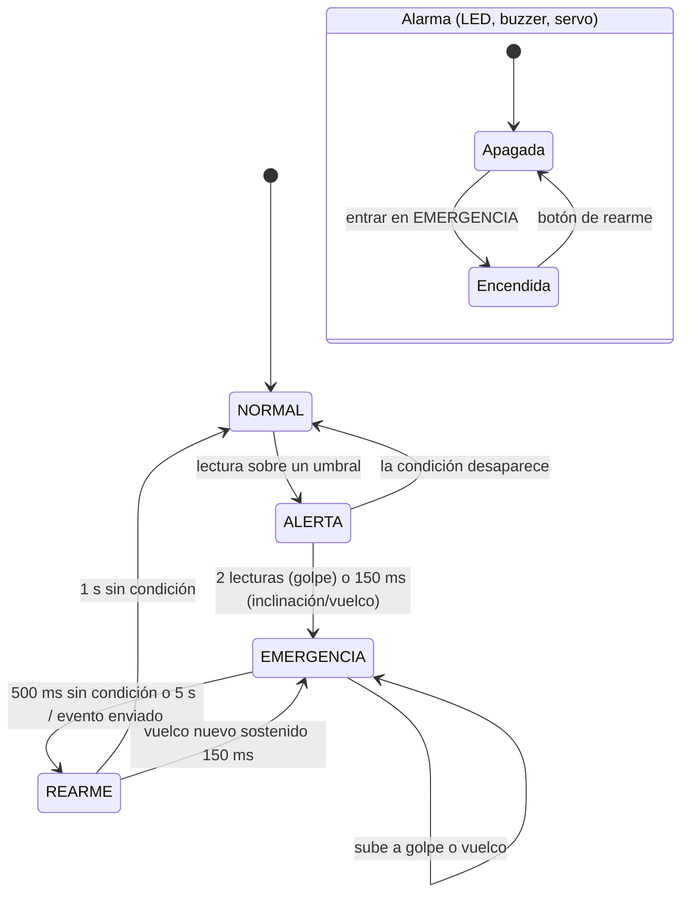

# Modelo del sistema de detección de accidentes (Grupo 11)

Base de la sección «Modelización» del informe. Describe el modelo que usan la simulación
(`web/src/simulation.js`) y el firmware (`firmware/carro_rc/carro_rc.ino`): las mismas variables, las
mismas ecuaciones y la misma máquina de estados. Valores vigentes: los de
`compartido/parametros-firmware.js`, que `npm test` compara con el `.ino`.

## 1. Variables, parámetros, entradas y salidas

**Variables de estado** (cambian en el tiempo):

| Símbolo | Nombre en el código | Unidad | Significado |
|---|---|---|---|
| a_x, a_y, a_z | `ax`, `ay`, `az` | m/s² | Aceleración medida por el MPU6050 en los ejes del carro (X adelante, Y izquierda, Z arriba). Incluye la gravedad. |
| ‖a‖ | `norma` | m/s² | Aceleración total √(a_x² + a_y² + a_z²) |
| ω_x, ω_y | `gx`, `gy` | °/s | Velocidad angular medida por el giroscopio (cero restado en la calibración) |
| φ_a, θ_a | `rollAcc`, `pitchAcc` | ° | Roll y pitch calculados solo con el acelerómetro |
| φ, θ | `roll_deg`, `pitch_deg` (`rollEst`, `pitchEst`) | ° | Roll y pitch estimados con el filtro complementario: los que usa la regla de inclinación y los que se envían a la API. Roll positivo: sube el lado izquierdo; pitch positivo: sube la trompa |
| n_g | `golpeSeguidas` | lecturas | Lecturas seguidas con ‖a‖ ≥ U_g |
| t_inc | `tInclIni` | ms | Instante de la primera lectura con \|φ\| o \|θ\| ≥ U_i (ángulos estimados) |
| E | `estadoDet` | — | Estado del detector: NORMAL, ALERTA, EMERGENCIA o REARME |
| A | `alarmaActiva` | sí/no | LED, buzzer y servo activos (hasta el botón de rearme) |
| ω_r | `rueda_rps` | vueltas/s | Giro de la rueda con el sensor Hall (dato secundario) |

**Parámetros** (fijos durante una prueba):

| Símbolo | Constante | Valor | Unidad |
|---|---|---:|---|
| U_g | `UMBRAL_GOLPE_MS2` | 16 | m/s² |
| N_g | `LECTURAS_GOLPE` | 2 | lecturas (8 ms) |
| U_i | `UMBRAL_INCLINACION_DEG` | 10 | ° |
| U_v | `UMBRAL_VUELCO_DEG` | 90 | ° |
| T_p | `PERMANENCIA_MS` | 150 | ms |
| T_c | `CIERRE_SIN_CONDICION_MS` | 500 | ms |
| T_max | `DURACION_MAX_EPISODIO_MS` | 5000 | ms |
| T_r | `REARME_DETECTOR_MS` | 1000 | ms |
| Δt | `PERIODO_ADQ_MS` | 4 | ms (250 Hz de lectura y decisión) |
| k | `MUESTRAS_POR_TEL` | 5 | lecturas por muestra publicada (50 Hz) |
| g | `G_MS2` | 9,80665 | m/s² |
| α | `ALFA_COMPLEMENTARIO` | 0,999 | — (τ = α·Δt/(1 − α) ≈ 4 s) |
| S_g | `LSB_POR_GRADO_S` | 16,4 | cuentas por °/s (giroscopio a ±2000 °/s) |
| m, b | `ANGULO_M`, `ANGULO_B` | 1, 0 | corrección opcional del ángulo (desactivada) |

**Entradas:** lecturas del MPU6050 por I2C en una sola transacción de 14 bytes: acelerómetro (±16 g) y giroscopio (±2000 °/s). También los pulsos del sensor Hall (secundario), botón de rearme
(pulsación corta: apaga la alarma; 3 s: reinicia el ESP32 y crea una sesión nueva).

**Salidas:** LED (GPIO 25), buzzer activo (GPIO 27), servo SG90 (GPIO 26, de 0° a 90°), y por Wi-Fi:
mediciones a 50 Hz con su `estado`, y eventos con tipo, gravedad, tiempos y latencias. **La alarma local
nunca depende del Wi-Fi.**

## 2. Ecuaciones

**Proyección de la gravedad.** Con el carro quieto y orientado con roll φ y pitch θ (primero el roll y
luego el pitch), la gravedad se reparte entre los ejes del sensor. En la simulación se suma además la
aceleración longitudinal a(t), la derivada de la velocidad:

- a_x = a(t) + g·sen θ
- a_y = g·sen φ·cos θ
- a_z = g·cos φ·cos θ

**Magnitud:** ‖a‖ = √(a_x² + a_y² + a_z²). En reposo vale g ≈ 9,81 m/s²: medir 9,81 no significa que el
carro se mueva.

**Roll y pitch del acelerómetro:**

- φ_a = atan2(a_y, a_z)·180/π
- θ_a = atan2(a_x, √(a_y² + a_z²))·180/π

Estas fórmulas suponen que la única aceleración es la gravedad. Al frenar, la desaceleración se proyecta
en el eje X: con a_x = −7 m/s² y el carro horizontal, θ_a = atan(−7/9,81) ≈ −35,5°. En el banco
nativo, la frenada del escenario `frenada` da |θ_a| máx. = 36,0° y, con solo el acelerómetro, el
detector registraba una inclinación a los 4155 ms. Corrección opcional del acelerómetro: φ_a' = m·φ_a + b
y θ_a' = m·θ_a + b (fase 4, `scripts/ajuste_curvas.py`).

**Filtro complementario** (firmware y simulación, en cada lectura, con el Δt medido):

- φ = α·(φ + ω_x·Δt) + (1 − α)·φ_a
- θ = α·(θ − ω_y·Δt) + (1 − α)·θ_a

El término del giroscopio sigue un giro real al instante. El del acelerómetro corrige la deriva de la
integración con una constante de tiempo τ = α·Δt/(1 − α). Una aceleración sin giro (frenar, arrancar,
curvar) solo entra por el término (1 − α), así que el ángulo estimado responde a ella como un filtro de
primer orden de constante τ. Para el roll, la diferencia φ + ω_x·Δt − φ_a se envuelve a ±180° (de +179° a
−179° hay 2°). El cero del giroscopio se mide en la calibración del arranque (500 lecturas con el carro
quieto) y se resta en cada lectura. Así un error de cero ε no produce una deriva ε·τ (1,5 °/s · 4 s = 6°
sin calibrar).

Elección de α: la frenada del banco dura ~1,3 s con θ_a de hasta 36°.

| α | τ | θ máx. estimado (banco nativo) | ¿Alarma? |
|---:|---:|---:|---|
| 0 (solo acelerómetro) | 0 s | 36,0° | sí, 4155 ms |
| 0,98 | 0,2 s | 34,4° | sí, 4335 ms |
| 0,999 | 4,0 s | 7,7° | no |

Con α = 0,999 la inclinación real con giro se detecta con la misma latencia que antes (152 ms desde que
el ángulo supera 10°). El vuelco se sigue decidiendo con φ_a: boca abajo o de costado, la gravedad lo
indica sin ambigüedad.

**Transición suave** (simulación). Para que la velocidad y los ángulos cambien sin saltos se usa
s(u) = 3u² − 2u³, con u = (t − t₀)/D limitado a [0, 1]. Vale s(0) = 0 y s(1) = 1, con pendiente 0 en
los dos extremos. Por ejemplo, el vuelco simulado es φ(t) = 180°·s((t − 3500)/2000).

**Contadores de permanencia** (se evalúan en cada lectura, cada Δt = 4 ms):

- Golpe: n_g ← n_g + 1 si ‖a‖ ≥ U_g, y n_g ← 0 si no. Se confirma cuando n_g ≥ N_g (2 lecturas).
- Inclinación (ángulos estimados φ, θ): t_inc es la primera lectura con |φ| ≥ U_i o |θ| ≥ U_i. Se confirma cuando
  t − t_inc ≥ T_p (150 ms). Si la condición se interrumpe, el contador vuelve a empezar.
- Vuelco (roll del acelerómetro φ_a): |φ_a| ≥ U_v sostenido T_p. Dentro de una emergencia, el tipo pasa a vuelco o golpe si
  aparecen (prioridad vuelco > golpe > inclinación).

**Latencias** (fase 1, medidas con `micros()` en el ESP32):

- latencia_deteccion = t_confirmación − t_primera lectura sobre el umbral
  - golpe: (N_g − 1)·Δt = 4 ms
  - inclinación y vuelco: ⌈T_p/Δt⌉·Δt = 152 ms
- latencia_activacion = t_órdenes a LED, buzzer y servo − t_confirmación (0,005 ms en el banco nativo;
  en la placa se medirá en las pruebas físicas). El giro del servo se verificará grabando la prueba de golpe.

**Muestreo publicado:** de cada grupo de k = 5 lecturas se envía la de mayor ‖a‖ (50 Hz). Así un pico de
una sola lectura (4 ms) nunca se pierde entre envíos.

## 3. Máquina de estados del detector

| Estado | Qué pasa | Sale hacia | Condición |
|---|---|---|---|
| NORMAL | Ninguna lectura supera los umbrales | ALERTA | ‖a‖ ≥ U_g, o \|φ\| o \|θ\| ≥ U_i (estimados) |
| ALERTA | Se cuenta la permanencia | NORMAL | la condición desaparece antes de confirmarse |
| | | EMERGENCIA | n_g ≥ N_g (golpe) o t − t_inc ≥ T_p (inclinación o vuelco) |
| EMERGENCIA | Evento confirmado: se activan LED, buzzer y servo, y se miden las latencias. El evento sigue abierto y puede subir a golpe o vuelco | REARME | T_c sin condición, o T_max desde la detección: el evento se cierra y se envía |
| REARME | El detector espera para no duplicar el mismo accidente | NORMAL | T_r (1 s) sin condición |
| | | EMERGENCIA | vuelco sostenido T_p si el último evento no fue vuelco (escalada) |

La **alarma física** es un estado aparte: se enciende al entrar en EMERGENCIA y solo se apaga con el
botón de rearme, aunque el detector ya haya vuelto a NORMAL. El estado del detector viaja en cada
medición (`estado`: `normal`, `alerta`, `emergencia`, `rearme`) y se ve en Monitor → En vivo.

## 4. Modelo frente a sensor: qué se comparó y cómo se verifica

- **Ángulo.** La simulación genera el ángulo real del carro, calcula a_x, a_y y a_z (con la aceleración del
  movimiento) y el giro ω = dφ/dt, y estima el ángulo con el mismo filtro que el firmware. En la gráfica
  de Simulación se ven los dos: real (discontinuo) y estimado (continuo). Frenada simulada:

  | Cálculo | α | θ máx. del detector | θ_a máx. | θ real | ¿Alarma? |
  |---|---:|---:|---:|---:|---|
  | Solo acelerómetro | 0 | 26,5° | 26,5° | 3,4° | sí |
  | Filtro complementario | 0,98 | 21,6° | 26,5° | 3,4° | sí |
  | Filtro complementario (firmware) | 0,999 | 4,1° | 26,5° | 3,4° | no |

  La misma conclusión sale del banco nativo con el firmware compilado (sección 2). El ángulo y la falsa
  alarma en la maqueta se verificarán en las pruebas físicas de marcha y frenada (pantalla Resultados).
- **Amplitudes de los escenarios.** Los escenarios sintéticos usan 2 m/s, 42° de inclinación y un choque de
  100 ms. Los valores físicos de cada repetición se comparan con ellos en Resultados (error absoluto y
  relativo). Ruido y saturación del sensor se pueden activar en Simulación (ruido, rango ±2…16 g).
- **Gravedad del evento.** `baja`, `media` y `alta` son etiquetas por tipo (inclinación media; golpe y
  vuelco alta), no una medida de energía del choque.
- **Rueda.** El sensor Hall mide una sola rueda, sin sentido de giro; se usa como dato secundario.
