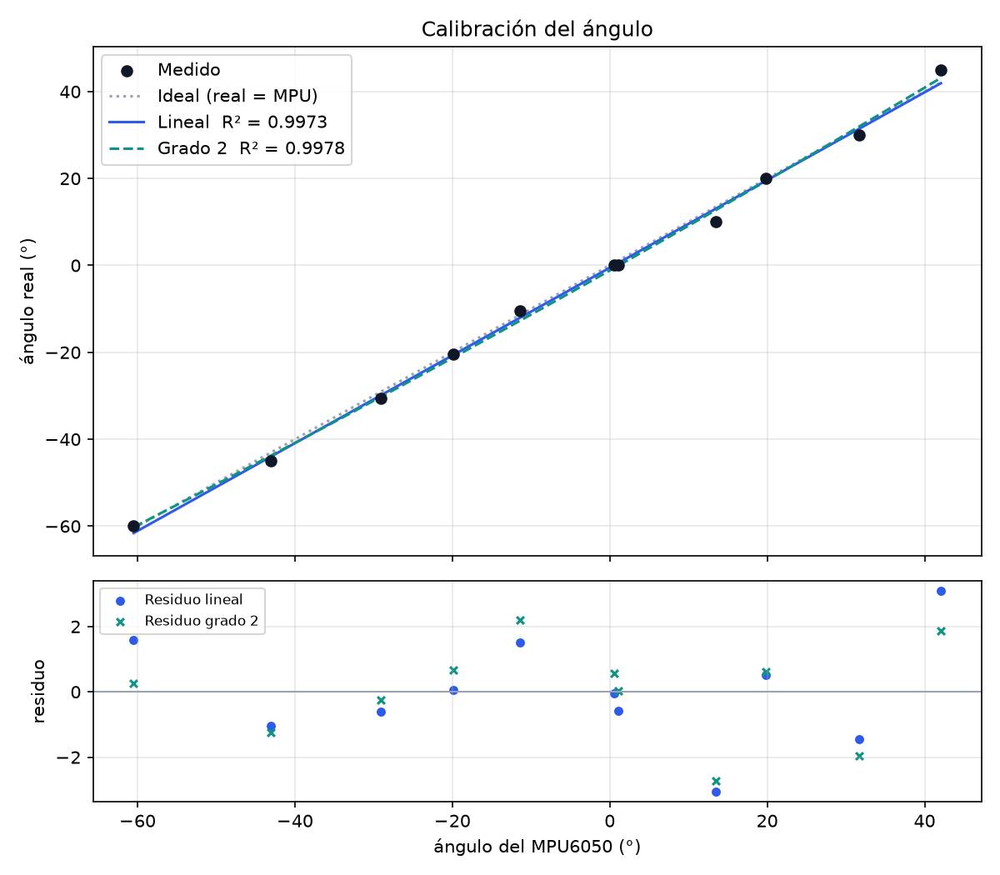

# Ajuste de curvas por mínimos cuadrados

Generado por `scripts/ajuste_curvas.py`. Recta de mínimos cuadrados:
m = (n·Σxy − Σx·Σy) / (n·Σx² − (Σx)²), b = (Σy − m·Σx) / n. R² = 1 − SS_res/SS_tot; R² ajustado = 1 − (1 − R²)(n − 1)/(n − grado − 1); error medio = media de |residuo|.

## a) Calibración del ángulo (transportador frente al MPU6050)

11 puntos. x = ángulo del MPU (°), y = ángulo real (°).

| Grado | R² | R² ajustado | Error medio (°) | RMSE (°) |
|---:|---:|---:|---:|---:|
| 1 | 0.9973 | 0.9970 | 1.234 | 1.592 |
| 2 | 0.9978 | 0.9972 | 1.126 | 1.428 |

- Lineal: **angulo_real = 1.0093·angulo_mpu − 0.5437**
- Grado 2: angulo_real = 0.0007·angulo_mpu² + 1.0218·angulo_mpu − 1.1773
- Se usa el ajuste de grado 1: el grado 2 solo baja el error medio 0.108 (< 0.5); un parámetro más con pocos puntos se ajusta al ruido. Se usa la recta, que además se programa con m y b.



Para activarlo en el carro, en `firmware/carro_rc/config_local.h`:

```c
#define CORRECCION_ANGULO 1
#define ANGULO_M 1.0093f
#define ANGULO_B -0.5437f
```

Luego compila, flashea y repite dos o tres ángulos con el transportador para comprobarlo.

## b) Tiempo de detección según el umbral

**Pendiente:** 0 puntos con 0 umbral(es) distinto(s) (se necesitan al menos 2 umbrales y 3 puntos; 1 fila(s) de ejemplo ignoradas). Para cada umbral (p. ej. 10°, 20°, 30°) cambia `UMBRAL_INCLINACION_DEG`, flashea, haz al menos 3 inclinaciones y anota `umbral,tiempo_deteccion_ms` en `datos/tiempos_deteccion.csv`, o ejecuta este script con `--api URL --umbral N` después de registrarlas en la web.

